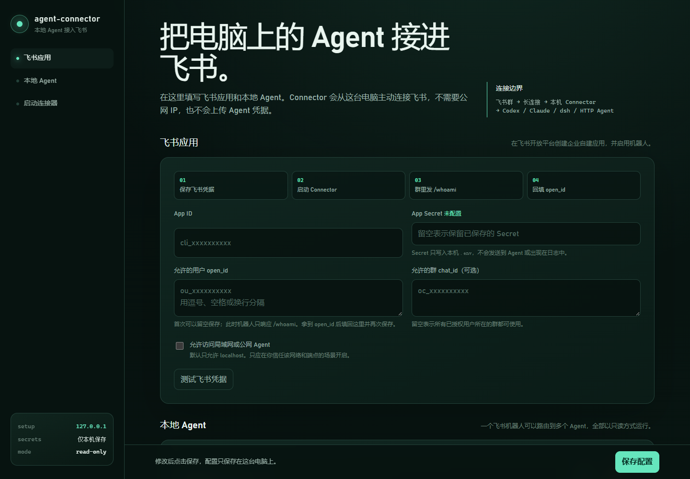

# agent-connector

[中文](README.md) | **English**

agent-connector is a local-first bridge between a Feishu bot and user-owned AI Agents. It runs on the user's computer, connects outward through Feishu's WebSocket long connection, and routes messages to local Codex, Claude, dsh, Hermes, generic CLI processes or HTTP Agents.

No public IP, port forwarding or tunneling service is required.



> This is a pre-1.0 community project. It is not an official Feishu, Lark or Agent-vendor product.

## Architecture

See [docs/ARCHITECTURE.md](docs/ARCHITECTURE.md).

If GitHub API requests work but `github.com` times out, see
[docs/GITHUB_NETWORK.md](docs/GITHUB_NETWORK.md).

```text
Feishu group
    |
    | Feishu WebSocket long connection
    v
Local agent-connector
    |-- CLI Agent
    `-- HTTP Agent (loopback by default)
```

Feishu cloud services cannot call a user's `127.0.0.1`. The Connector therefore lives on the user's machine and creates an outbound connection to Feishu.

## Quick start

Requirements: Windows 10/11, Node.js 20+, and a Feishu custom app with bot capability.

```powershell
npm ci
.\setup.ps1
```

Open the local setup console, configure the Feishu App ID, App Secret and Agent, save, then run:

```powershell
.\start.ps1
```

Send `/whoami` to the bot, add the returned `open_id` to the allowlist, save and restart the Connector.

See [QUICKSTART.md](QUICKSTART.md) for the full Chinese walkthrough.

## Commands

```text
/help
/whoami
/agents
/status
/ask <agent> <question>
/<agent> <question>
```

## Security

- Feishu text is untrusted and is never concatenated into a shell command.
- The setup console is loopback-only, validates the Host header and requires a session token.
- Secrets stay in the local `.env` file and are excluded from Git.
- CLI Agents inherit the Connector process permissions; read-only configuration is not a full sandbox.
- HTTP Agents are loopback-only unless remote endpoints are explicitly enabled.

Report vulnerabilities according to [SECURITY.md](SECURITY.md).

## Contributing

Read [CONTRIBUTING.md](CONTRIBUTING.md), run `npm run verify`, and remove all secrets and personal identifiers from issues and pull requests.

## License

[MIT](LICENSE)
