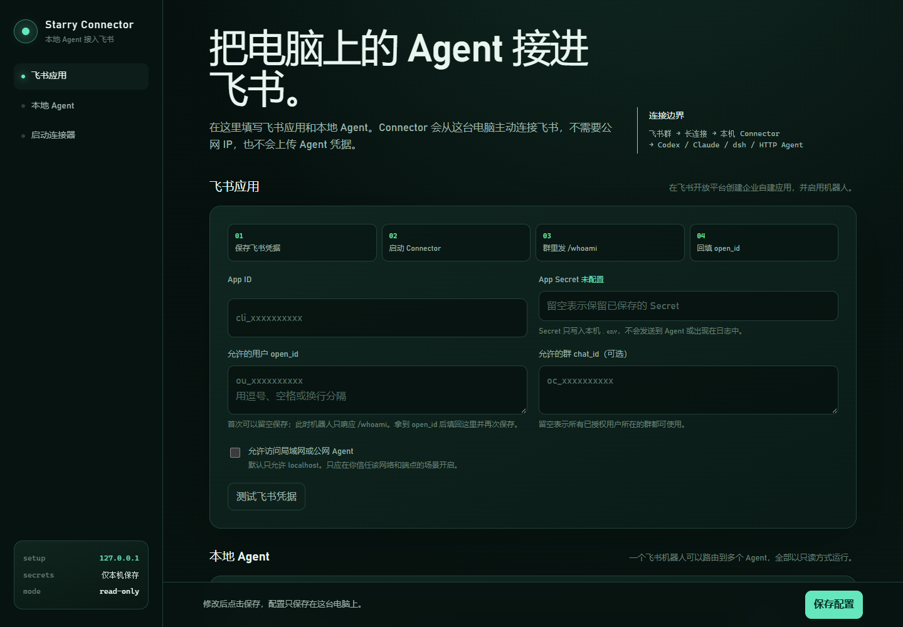

# Starry Agent Connector

**中文** | [English](README.en.md)

一个 local-first 的飞书机器人连接器：用户在自己的电脑运行 Connector，把飞书消息路由给本地的 Codex、Claude、dsh、Hermes 或其他 CLI / HTTP Agent。Connector 通过飞书 WebSocket 长连接主动外连，不需要公网 IP、端口映射或内网穿透。



> 当前为 pre-1.0 内测版本。它不是飞书官方产品，也不声称与飞书、Lark、Codex、Claude 或其他 Agent 厂商存在官方关联。

## 为什么需要 Connector

飞书云端不能访问用户电脑的 `127.0.0.1`。只填一个 localhost 地址的“云端飞书插件”无法工作。正确的安全边界是：

```text
用户飞书群
    |
    | 飞书 WebSocket 长连接
    v
本机 Starry Connector
    |-- CLI Agent（Codex、Claude、dsh、Hermes 等）
    `-- HTTP Agent（127.0.0.1、局域网或用户明确允许的远程服务）
```

代码、Agent 凭据和本地配置默认只保留在用户电脑。当前版本不需要 Starry 云端服务。

## 能力

- 一个飞书机器人映射多个 Agent。
- 本机图形化配置台，支持凭据测试、Agent 测试、allowlist 和并发限制。
- CLI Agent 直接 `spawn`，不通过 shell；HTTP Agent 使用固定 endpoint。
- 首次允许空 allowlist，此时机器人只响应 `/whoami`，不会运行 Agent。
- 异步 Job：群内立即确认，任务完成后主动回传结果。
- 默认只读，写入能力尚未开放。
- Windows 便携包构建脚本。

## 快速开始

要求 Windows 10/11、Node.js 20+，以及可以创建飞书企业自建应用的账号。

```powershell
npm ci
.\setup.ps1
```

配置台只监听 `http://127.0.0.1:43120`。填写 App ID、App Secret 和 Agent 后保存，再运行：

```powershell
.\start.ps1
```

首次可以留空 `open_id`。在飞书群里发送 `/whoami`，把返回的 `open_id` 填回配置台，再次保存并重启 Connector。

完整步骤见 [QUICKSTART.md](QUICKSTART.md)。移动端配置台预览见 [setup-mobile.png](docs/screenshots/setup-mobile.png)。

## 飞书应用设置

1. 创建企业自建应用并启用机器人。
2. 添加发送消息权限 `im:message:send_as_bot`。
3. 订阅 `im.message.receive_v1`，接收方式选择“使用长连接接收事件”。
4. 发布应用并把机器人加入测试群。

同一个飞书应用通常只允许一条长连接接收事件。启动 Connector 前，停止占用同一 App 的其他 Gateway。不要把 App Secret 发到聊天、Issue、PR 或截图；若曾泄露，请立即在飞书后台重置。

## 飞书命令

```text
/help
/whoami
/agents
/status
/ask codex 检查当前项目最大的风险
/ask local-http 你好
/codex 检查当前项目最大的风险
```

`/ask <agent> <问题>` 是通用命令。Agent ID 安全且唯一时，也支持 `/<agent>` 快捷方式。

## Agent 配置

CLI Agent 直接启动可执行文件。`{prompt}` 可放在 `stdin` 或参数中：

```json
{
  "id": "codex",
  "type": "cli",
  "executable": "codex",
  "args": ["exec", "--sandbox", "read-only", "-"],
  "cwd": "C:\\path\\to\\your\\project",
  "stdin": "{prompt}",
  "timeoutMs": 1200000,
  "readOnly": true
}
```

HTTP Agent 默认只允许回环地址。远程 endpoint 必须显式开启 `allowRemoteAgentEndpoints`：

```json
{
  "id": "local-http",
  "type": "http",
  "endpoint": "http://127.0.0.1:8787/ask",
  "method": "POST",
  "body": {"prompt": "{prompt}", "chatId": "{chatId}"},
  "responsePath": "answer",
  "timeoutMs": 300000,
  "readOnly": true
}
```

示例文件为 [agents.example.json](agents.example.json)。真实配置写入被 Git 忽略的 `agents.json`。

## 开发与验证

```powershell
npm ci
npm test
npm run verify
npm run package:windows
```

`npm run verify` 会运行测试和 public-tree 审计，检查凭据、个人信息、本地绝对路径以及运行数据是否可能进入公开仓库。

## 安全边界

- 飞书消息是 untrusted input，不拼接成 shell 命令。
- 配置台只绑定回环地址，校验 Host，并要求一次性的会话令牌。
- App Secret 只存储在本地 `.env`，不会由配置 API 返回。
- CLI Agent 使用独立进程启动，但仍继承 Connector 的运行权限。
- “只读”配置不能代替操作系统沙箱、容器或专用账号。

安全问题请按 [SECURITY.md](SECURITY.md) 私下报告。

## 项目状态与路线

当前交付的是“用户自带飞书应用 + 本机 Connector”的内测版。正式飞书应用市场版本还需要 Starry Relay、设备绑定、多租户隔离、审批与审计。详见 [PRODUCTIZATION.md](PRODUCTIZATION.md) 和 [docs/ARCHITECTURE.md](docs/ARCHITECTURE.md)。

## 参与贡献

- [CONTRIBUTING.md](CONTRIBUTING.md)
- [CODE_OF_CONDUCT.md](CODE_OF_CONDUCT.md)
- [SUPPORT.md](SUPPORT.md)
- [CHANGELOG.md](CHANGELOG.md)
- [发布到 GitHub 前的检查清单](docs/PUBLISHING.md)
- [GitHub 连接不稳定时的排障说明](docs/GITHUB_NETWORK.md)

## License

[MIT](LICENSE)
